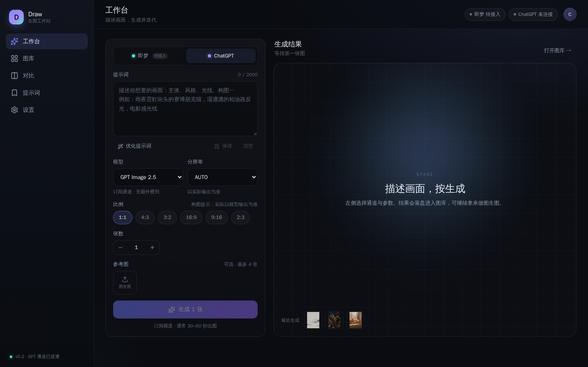
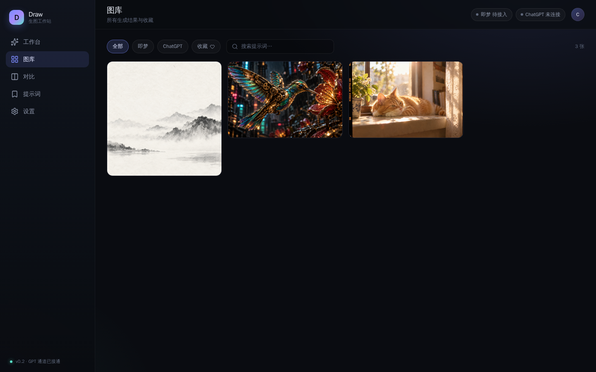
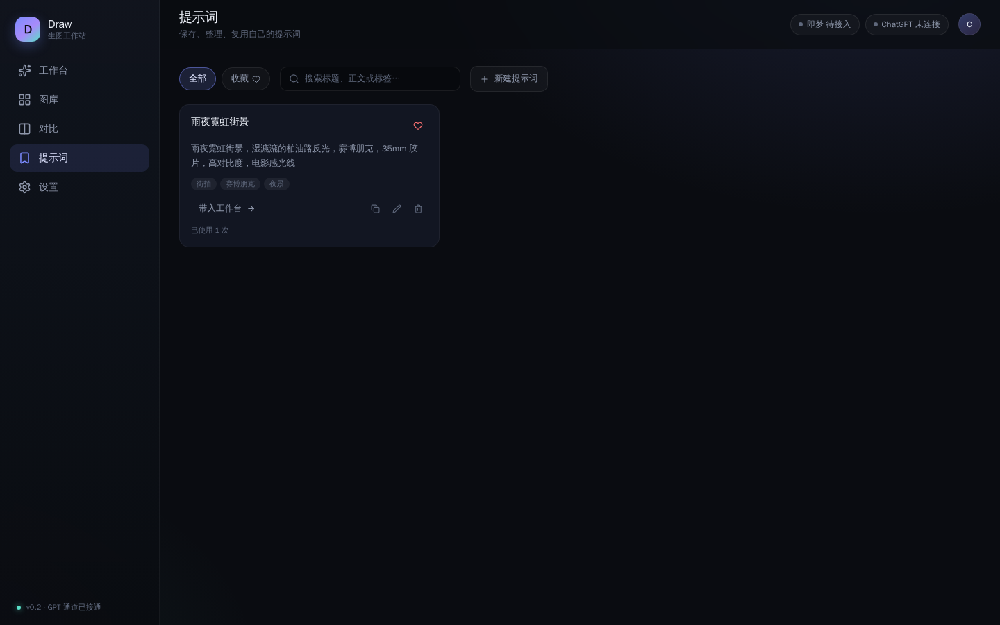
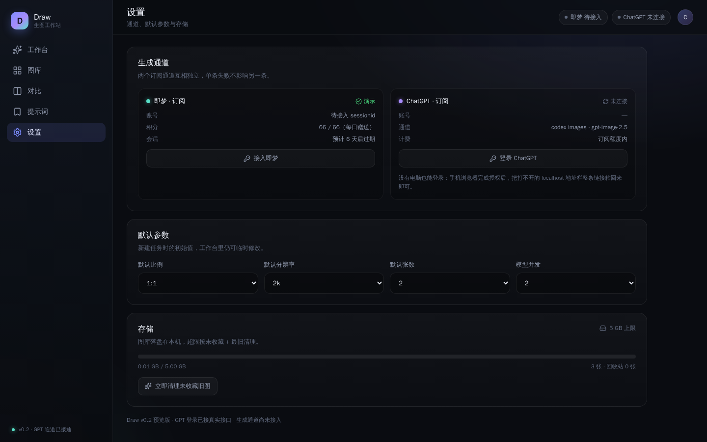

# Draw Image Studio

个人 AI 生图工作站：一个自建的 Web UI，把 **ChatGPT 订阅**（已实现）和 **即梦订阅**（规划中）变成日常可用的出图工作台——提示词、参数、生成、图库、提示词库都在自己的服务器上，图片落盘在自己的硬盘，凭据加密存本机。

不依赖第三方 SaaS 后台，也不是某个平台的客户端壳：前端、后端、存储、登录全部在这个仓库里。



## 功能

- **工作台**：提示词、通道与模型切换、比例、参考图位、生成进度、结果网格
- **ChatGPT 订阅通道**：OAuth PKCE 登录（回调不可达时手动粘贴授权链接，手机也能完成）、token 自动刷新、真实出图
- **图库**：真实文件落盘、按通道/收藏筛选、提示词搜索、详情抽屉、收藏与软删除、批量选择删除
- **图生图**：参考图可上传或直接从图库选（最多 4 张、单张 ≤4MB，自动压缩到 1536 长边），ChatGPT 走 codex edits、即梦走 filePaths
- **批量生成**：工作台「批量」模式，每行一个提示词、最多 8 组，串行出图并显示队列进度
- **清理与配额**：设置页一键清理未收藏旧图；图库「回收站」可恢复 30 天内删除的图，超期物理清理
- **提示词库**：保存、编辑、打标签、收藏、一键带入工作台，跨设备共享
- **多通道对比**：同一提示词同时发给 ChatGPT 与即梦，结果并排出图、自动进图库，附耗时与积分

| 图库 | 提示词库 |
| --- | --- |
|  |  |

## 技术栈

- 前端：Vite + React 19 + 原生 CSS，无 UI 框架
- 后端：Node 24 原生 `node:http` + `node:sqlite`，零 npm 依赖
- 存储：SQLite（元数据）+ 本地文件（`data/media/YYYY/MM/`）
- 部署：nginx 反向代理 + systemd；对外建议挂站点级 SSO

## 目录

```
app/      前端源码（Vite + React）
server/   后端源码（单文件 src/index.mjs）
docs/     截图与设计文档
PLAN.md   方案与实施记录
```

## 部署概要

1. 构建前端：`cd app && npm install && npm run build`（产物输出到 `../web`）
2. 调整 `server/src/index.mjs` 顶部的数据目录（默认 `/var/www/html/draw/data`）
3. systemd 运行 `node server/src/index.mjs`，默认监听 `127.0.0.1:30300`
4. nginx：
   - `/draw/` → 前端 `web/`（SPA 回退到 `index.html`）
   - `/draw/api/` → `127.0.0.1:30300`
   - `/draw/media/` → `data/media/`
   - 建议以上全部挂在站点 SSO 之后

## 鉴权（两种模式）

- `DRAW_AUTH=token`（默认）：后端自己校验访问。首次启动会生成 `data/secrets/access-token`（0600）并在日志打印一次，打开页面输入该 token 即可登录；也可用 `DRAW_ACCESS_TOKEN` 环境变量指定或轮换。脚本调用支持 `Authorization: Bearer <token>`。
- `DRAW_AUTH=external`：信任反向代理的登录（如站点级 SSO、Basic Auth），后端不做二次校验。适合已有统一登录的部署。

登录会话使用 HttpOnly 签名 Cookie（30 天，SameSite=Lax），右上角头像可退出登录。nginx 只需按所选模式决定是否在 `/draw/` 上挂 `auth_request`。

## 登录 ChatGPT（订阅通道）

设置页 → 登录 ChatGPT → 页面给出一串 8 位验证码（例如 `D9UT-EDIJP`）→ 在任意设备打开 <https://auth.openai.com/codex/device> 输入验证码并授权。Draw 会自动轮询并在授权完成后保存 token，**不需要复制 localhost 链接**。

旧的回调链接方式保留为折叠备选：授权后浏览器跳到 `localhost:1455` 打不开属正常，复制地址栏整条 URL 粘回页面即可。token 刷新由后端自动处理。



## 安全与边界

- 凭据使用 AES-256-GCM 加密存在本机 SQLite，主密钥 `data/secrets/master.key`（0600），不进日志、不进仓库
- ChatGPT 通道走的是订阅账号的**内部接口**（`chatgpt.com/backend-api/codex/images/*`），不是官方公开 API，存在改版与风控风险，请仅作个人使用
- 若接入即梦反代（`jimeng-free-api-all`，GPL-3.0），应以独立进程运行、只通过 HTTP 调用，不要链接其代码
- 生产环境请务必挂认证，不要把这个服务直接暴露在公网无鉴权状态

## 已知限制

- ChatGPT 通道每次生成 1 张，单张约 30–60 秒
- 模型会忽略 `size` 参数，输出比例以实际为准（UI 已标注）


## 分支

- `main`：稳定可运行版本，只在确认可用后合并
- `develop`：开发分支，新功能与调整先在这里迭代（当前活跃开发分支）

## License

MIT
